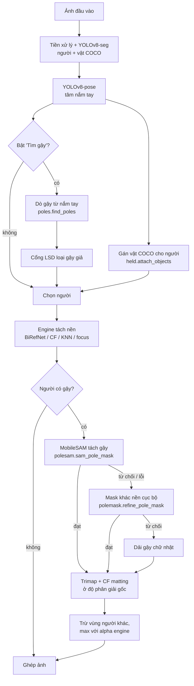

# Công nghệ tách gậy và đồ vật cầm tay của người chạy

*Cập nhật: 2026-11-09 · mã nguồn: `backend/pipeline/`*

App giữ màu người chạy và làm xám nền. Vật cầm trên tay (gậy leo núi, chai nước, điện thoại...) cũng phải giữ màu cùng người. Có hai đường xử lý:

- **Vật thông thường** (chai, điện thoại, ô...): dùng luôn mask lớp COCO do YOLOv8-seg trả về, gán cho người có nắm tay gần nhất rồi gộp vào mask người.
- **Gậy leo núi**: COCO không có lớp này, nên đi một chuỗi riêng: tự dò gậy từ nắm tay, tách hình dạng gậy bằng MobileSAM, rồi tính alpha ở độ phân giải gốc bằng closed-form matting.

## 1. Vì sao gậy khó

| Khó khăn | Hệ quả nếu không xử lý riêng |
|---|---|
| Gậy rất mảnh: 3–8 px trên ảnh 1600 px | Engine tách nền chạy ở độ phân giải làm việc thấp hơn, gậy mất khi thu nhỏ |
| COCO không có lớp "gậy leo núi" | YOLO không phát hiện được, phải tự dò |
| Gậy không đều: có cán, quai, núm, nhiều đoạn màu, hay cầm hai gậy song song | Mô hình "thanh thẳng đều màu" bỏ sót cán, bỏ sót gậy thứ hai |
| Đầu gậy lẫn vào đá, cỏ, lá | Đường dò chạy quá đầu gậy thật |
| Ảnh nhiều người, gậy đè lên người khác | Phải phân xử gậy thuộc ai, tránh giữ màu người đứng sau |

## 2. Pipeline tổng thể



Hai giai đoạn tách biệt (mặc định `POLE_SCOPE=selected`: gậy được dò ở giai đoạn 2, chỉ cho người được chọn):

1. **`/detect`** (`detect.detect_scene`): YOLO-seg, YOLO-pose, gán vật COCO. Với `POLE_SCOPE=all` còn dò gậy cho mọi người và lưu thành *ứng viên* (`scene.pole_candidates`); với `selected` (mặc định) chỉ đặt cờ `scene.poles_lazy`.
2. **`/process`** (`segment.build_cutout`): khi người dùng chọn một người, gậy của đúng người đó được dò (nếu `poles_lazy`: `poles.find_poles_for` quét tay người đó, rồi quét thêm người nào có tay cách trục gậy ≤ 0.08 h để phân xử; kết quả, kể cả rỗng, được nhớ trong `scene.pole_candidates`) và gộp (`held.apply_poles`: nới box, ghi nhãn, **không** vẽ gậy vào mask), engine chạy, rồi `thin.overlay_poles` phủ alpha gậy lên kết quả của mọi engine.

Gậy không được vẽ vào mask người vì mask là mồi của engine: BiRefNet nở mask ~4% box, nên gậy trong mask kéo cả nền cạnh gậy vào alpha.

### Công tắc

| Nơi | Tên | Mặc định | Tác dụng |
|---|---|---|---|
| Giao diện | "Tìm gậy cầm tay" | tắt | Gửi `poles=true` cho `/detect`; đổi công tắc thì phát hiện lại ảnh |
| API | `/detect?poles=` | `false` | Bật dò gậy cho lượt phát hiện này |
| Môi trường | `POLE_ENABLE` | `1` | Công tắc tổng; `0` thì không dò gậy dù `poles=true` |
| Môi trường | `POLE_SAM` | `1` | `0` = bỏ MobileSAM, dùng mask cũ |
| Môi trường | `POLE_REFINE` | `1` | `0` = bỏ mask khác nền cục bộ (phương án dự phòng) |
| Môi trường | `HELD_ENABLE` | `1` | `0` = tắt mọi xử lý vật cầm tay (cả pose) |

## 3. Phát hiện người và nắm tay

**YOLOv8s-seg** (Ultralytics, `detect.py`) cho box + mask người và cả mask của các lớp COCO trong `HELD_CLASSES` (balo, ô, túi, chai, cốc, điện thoại, sách...; bỏ phương tiện, động vật, đồ nội thất lớn). Không thấy ai thì thử lại theo `DETECT_ATTEMPTS` = (conf 0.25, 640) → (0.15, 960) → (0.10, 1280), kèm chuỗi tiền xử lý mạnh hơn.

**YOLOv8s-pose** (`pose.py`, imgsz 960) cho 17 keypoint COCO. Tâm nắm tay được ngoại suy từ cẳng tay:

```
nắm tay = cổ tay + 0.35 × (cổ tay − khuỷu)
```

Chỉ dùng khi cả khuỷu và cổ tay có độ tin cậy ≥ 0.3 (`HAND_MIN_CONF`). Mỗi pose ghép với người có IoU box ≥ 0.5 cao nhất.

Đơn vị chiều dài dùng khắp phần sau là **h = chiều cao thân người** (`Person.body_h`, tính trên box thân, không tính vật cầm tay thò ra), nên các ngưỡng không phụ thuộc kích thước ảnh.

**Gia tốc phần cứng**: YOLO chạy trên CPU, CUDA, MPS hoặc OpenVINO (GPU Intel, IR FP16 xuất một lần vào `ACCEL_CACHE_DIR`); GPU lỗi thì tự chạy lại bằng CPU.

## 4. Đồ vật COCO cầm tay (`held.py`)

`attach_objects` gán mỗi vật (conf ≥ 0.25) cho một người:

1. Bỏ vật có diện tích > 1.5 × mask người (vật quá lớn so với người).
2. Người có tay: khoảng cách từ box vật tới nắm tay gần nhất ≤ 0.08 h (`HELD_HAND_DIST`); xếp hạng theo khoảng cách.
3. Người không có tay (pose hụt): mask vật nới 0.03 × cạnh dài box vật phải chạm mask người; xếp sau người có tay.
4. Vật thuộc người có điểm tốt nhất: mask vật được OR vào mask người, box người nới ra, lưu box thân cũ vào `body_box`.

Vật COCO có mask đủ dày nên engine tách nền xử lý được, không cần bước alpha riêng như gậy.

## 5. Dò gậy (`poles.py`, `linecheck.py`)

Bộ dò là thuật toán thủ công, không học máy, chạy trên ảnh Lab đã làm mờ nhẹ (σ = 1.2).

### 5.1 Phép thử "mặt cắt dạng thanh"

Tại mỗi điểm mẫu, lấy màu tâm `c` và hai điểm hai bên cách tâm `hw + 4` px theo pháp tuyến (`l`, `r`). Điểm đạt khi:

```
|c − (l + r)/2| > 0.05          (tâm khác hẳn hai bên, Lab chia 255)
|l − r| < 0.7 × |c − (l + r)/2| (hai bên giống nhau → loại mép của vùng lớn)
```

Phép thử chạy với nhiều nửa bề rộng `hw` ∈ {0.002, 0.003, 0.005, 0.008, 0.012} × h (0.012 để bắt gậy tre); bề rộng được chọn là bề rộng hẹp nhất có số mẫu đạt ≥ 90% mức tốt nhất.

### 5.2 Lượt 1: quét xuống từ nắm tay

Gậy thường cầm ở đầu trên, chống xuống đất.

- Với mỗi tay, quét tia theo góc 45°–135° (90° = thẳng xuống), bước 0.5°; dịch gốc tia ±0.03 h theo pháp tuyến (bước 6 px).
- Lấy mẫu dọc tia trong đoạn [0.06 h, 0.55 h] (bỏ phần nắm tay), bước 3 px.
- Điểm của góc = số mẫu đạt của chuỗi liền dài nhất (hụt ≤ 0.05 h) / số mẫu trong ảnh. Góc tốt nhất cần điểm ≥ 0.5.
- **Bám theo gậy** (`_trace`): đi tiếp dọc tia tới mép ảnh, mỗi bước được lệch ngang ±1 px để bám theo gậy hơi cong / tia lệch góc; hụt > 0.05 h thì dừng. Dò ngược lên trên nắm tay tối đa 0.12 h để lấy cán.
- **Cắt đuôi thưa**: thân gậy thật cho mật độ mẫu đạt gần 1; khi đường dò chạy qua cỏ thì mật độ rơi xuống 0–0.6. Chia đường theo cửa sổ 0.03 h, đầu gậy = cuối cặp cửa sổ đặc (≥ 0.8) cuối cùng nếu phần sau thưa (< 0.6).
- Gậy ngắn hơn 0.2 h bị bỏ.

### 5.3 Phân xử chủ gậy

Hai tay (của hai người) có thể dò ra cùng một gậy (khoảng cách vuông góc trung bình giữa hai trục < 2 hw + 6 px). Gậy thuộc người có **mask bọc chỗ nắm nhiều hơn** (tỉ lệ pixel mask trong đĩa bán kính 0.04 h quanh điểm trên trục gần tay nhất); hoà thì tay gần trục hơn thắng. Người thua loại các góc ±3° quanh gậy đó rồi tìm ứng viên khác; lặp tới khi hết tranh chấp.

### 5.4 Cổng LSD: loại gậy giả

Gậy thật có hai mép thẳng mà **LSD** (Line Segment Detector của OpenCV) bắt được; đường dò giả (cỏ, hàng rào, mép chân) gần như không có đoạn LSD song song.

- LSD chạy một lần trên toàn ảnh xám đã cân bằng **CLAHE** (clip 2.0, lưới 8×8), ảnh lớn được thu về cạnh dài 1600 px (ngưỡng được chọn ở độ phân giải này; LSD không bất biến tỉ lệ).
- **Độ phủ** = tỉ lệ mẫu dọc trục (bước 3 px) nằm trong một đoạn LSD lệch góc ≤ 4° và cách trục ≤ hw + 3 px. Gậy thật ~0.6, giả ~0.02; giữ gậy có độ phủ ≥ 0.25.
- Trên 40 ảnh gán nhãn thủ công: giữ 41/44 gậy thật, loại 44/49 gậy giả.

### 5.5 Lượt 2: quét hai phía

Cho tay chưa có gậy sau lượt 1 (gậy cầm giữa thân, gậy gần nằm ngang): quét hướng trục 15°–165°, mỗi hướng bám về **cả hai phía** chỗ nắm. Đạt khi mật độ mẫu đạt ≥ 0.6 và tổng chiều dài ≥ 0.15 h; trục được khớp lại bằng PCA qua các điểm đã bám (sau khi dời mỗi điểm về tâm gậy). Sau cổng LSD, hai đầu được cắt về đoạn có độ phủ LSD cục bộ ≥ 0.5, và phần gậy dưới chỗ nắm phải ≥ 0.12 h. Phần tính toán được vector hoá theo khối hướng (tối đa 200 000 điểm mẫu mỗi khối).

Kết quả mỗi gậy là một `Pole`: đầu trên, đầu dưới, nửa bề rộng, điểm, chỉ số người cầm.

## 6. Tách gậy bằng MobileSAM (`polesam.py`)

Bộ dò chỉ cho trục thẳng + bề rộng đều. **MobileSAM** (Segment Anything bản nhẹ, encoder TinyViT ~40 MB, chạy qua `ultralytics.SAM`) tách theo hình dạng thật, nên lấy được cán phía trên tay, dừng đúng đầu gậy và bắt cả gậy thứ hai cầm song song.

### 6.1 Prompt

1. **Chỗ nắm** = hình chiếu lên trục của tay gần trục nhất (cách trục ≤ 0.05 h); không có thì là đầu trên.
2. **Điểm dương** đặt cách chỗ nắm 0.07 h, 0.15 h, 0.25 h về mỗi phía (bỏ chính nắm tay), không quá nửa đoạn tới đầu gậy phía đó; phía ngắn hơn 0.1 h thì bỏ. Chỉ đặt gần chỗ nắm vì đầu xa của trục có thể chạy quá đầu gậy thật: điểm rơi vào đá làm SAM tô cả mảng đá.
3. **Dời điểm về tâm gậy** (`_snap`): trục dò có thể lệch khỏi gậy vài chục px (gậy sát mép ảnh). Mỗi điểm dương được dời theo pháp tuyến trong ±max(6 px, 0.015 h) tới chỗ có điểm `|c − (l+r)/2| − |l − r|` lớn nhất (Lab 8 bit); không chỗ nào đạt 12 thì bỏ điểm. Còn < 2 điểm dương thì không chạy SAM.
4. **Điểm trên cán / quai**: thêm một điểm dương cách đầu trên `0.3 ×` khoảng cách đầu trên → chỗ nắm (không dời, vì cán rộng hơn thân gậy nên `_snap` sẽ bỏ). Đoạn từ tay lên đầu gậy thường quá ngắn cho khoảng cách 0.07/0.15/0.25 h nên nếu không thì cán bị bỏ sót.
5. **Điểm âm** đặt hai bên mỗi điểm dương, cách trục `hw + 0.02 h`.
6. SAM chạy trên **vùng cắt** quanh gậy (nới max(0.15 × chiều dài gậy, 0.05 h)), không phải toàn ảnh, để gậy mảnh không bị thu nhỏ quá khi SAM resize về 1024.

### 6.2 Hậu xử lý và kiểm tra

1. Bỏ pixel mask cách đường trục > 0.06 h (tràn sang vật khác).
2. Chỉ giữ thành phần liên thông chạm vào các điểm dương.
3. Từ chối (quay về phương án dự phòng) nếu:
   - mask < 0.3 × diện tích dải gậy dò được (SAM trượt khỏi gậy);
   - mask > 0.025 h² (tràn sang nền / người);
   - bề rộng trung bình = diện tích / chiều dài dọc trục > max(3 × bề rộng dải, 0.025 h). Gậy + bàn tay + gậy song song ~0.02 h, mảng lá ~0.05 h.

**Nối / kéo dài đuôi** (`_extend`): bộ dò có thể dừng sớm (đoạn dưới mờ, bị lá che) trong khi gậy còn tiếp, hoặc SAM bỏ lỡ một đoạn gậy xám trên nền xám. Mask dừng *trước* đầu gậy dò được, hoặc chạm *mép vùng cắt* quá đầu gậy, thì đặt điểm dương ngoại suy dọc trục (cách nhau 0.04 h, tới 0.18 h quá đầu gậy, trong ảnh) và chạy SAM lần hai trên vùng cắt dài hơn. Chỉ nhận đoạn thêm là đoạn đầu liền mạch và mảnh (bề rộng TB mỗi ô ≤ max(3 × bề rộng dải, 0.012 h)), dài ≥ 0.02 h và phủ ≥ 50% khoảng đã đặt điểm; phần thân giữ nguyên từ lượt một. Ca gậy dò quá đầu gậy thật (điểm rơi vào đá / cỏ) không cho đường mảnh liền mạch nên bị từ chối. Mask dừng tự nhiên quanh đầu gậy thì không tốn lượt thứ hai.

Model nạp lười một lần và dùng chung, suy luận có khoá luồng; lần đầu tự tải `mobile_sam.pt` vào `ACCEL_CACHE_DIR`. Nạp lỗi thì nhớ lỗi và luôn dùng phương án dự phòng; mọi lỗi khác chỉ ghi log, request không bao giờ hỏng.

### 6.3 Phương án dự phòng (`polemask.py`)

Khi SAM từ chối: mask "khác nền cục bộ". Ảnh được xoay theo trục gậy; nền hai bên ước lượng bằng trung vị theo cửa sổ dọc trục cộng inpaint Telea; pixel là ứng viên khi khoảng cách Lab tới nền vượt ngưỡng (22, cộng thêm theo độ gồ ghề của nền). Ứng viên được lọc theo độ mảnh, dính vào dải gậy, hướng song song trục (khớp đường Huber, lệch ≤ 15°, hội tụ về chỗ nắm) hoặc là khối nhỏ ở đầu gậy. Không chắc (nền quá gồ ghề, thêm quá nhiều) thì dùng dải gậy chữ nhật quanh trục.

Bảng so sánh ba cách:

| Cách | Bắt cán / núm | Dừng đúng đầu gậy | Gậy song song | Nền nhiều vân |
|---|---|---|---|---|
| Dải gậy chữ nhật | không | không | không | ổn định |
| Mask khác nền cục bộ | một phần | không | có (nền trơn) | tự tắt khi nền gồ ghề |
| MobileSAM | có | có | có | tốt, có kiểm tra độ rộng |

## 7. Alpha gậy ở độ phân giải gốc (`thin.py`)

Sau khi engine tách nền xong, mỗi gậy được matting lại trên **ảnh đầy đủ** (không thu nhỏ):

1. **Trimap**:
   - Mask SAM: vùng chắc chắn là gậy = mask co 1 px ∪ đường tâm (đỉnh của biến đổi khoảng cách, để chỗ gậy chỉ 2–3 px không mất khi co); vùng chưa biết = dải 2 px (`THIN_BAND_PX`) quanh mask; còn lại là nền. **Không gộp dải gậy dò được**, nên đoạn trục chạy quá đầu gậy không lọt vào alpha.
   - Mask dự phòng: như trên nhưng gộp thêm lõi dải gậy.
   - Dải gậy: lõi dải = chắc chắn, ±2 px quanh mép = chưa biết.
2. **Closed-form matting** (Levin et al., thư viện `pymatting`) trên vùng cắt quanh gậy cho alpha mềm ở mép.
3. **Trừ vùng người khác** (`occlusion.exclusion_mask`): pixel thuộc mask người khác bị đặt alpha 0; người khác đứng **gần máy ảnh hơn** (chân thấp hơn) thì loại cả vùng của họ, đứng xa hơn thì chỉ loại phần không chồng lên người đang xử lý. Khi tính phần này, dải gậy được coi là "của mình" để gậy đè lên người đứng xa hơn không bị xoá.
4. **Gộp**: `alpha = max(alpha engine, alpha gậy)`; pixel có alpha tăng lấy màu tiền cảnh từ ảnh gốc.

Trace bước *Alpha gậy ở độ phân giải gốc* ghi số gậy, số gậy dùng MobileSAM và số gậy dùng mask dự phòng.

## 8. Tham số chính (`config.py`)

| Tham số | Giá trị | Ý nghĩa |
|---|---|---|
| `HAND_EXTRAP` | 0.35 | Nắm tay = cổ tay + 0.35 × (cổ tay − khuỷu) |
| `HELD_HAND_DIST` | 0.08 | Vật COCO cách nắm tay ≤ 0.08 h |
| `POLE_ANGLES` | 45°–135° | Góc quét xuống (lượt 1) |
| `POLE_SEARCH` | 0.06–0.55 h | Đoạn tia tính điểm |
| `POLE_HALF_W` | 0.002–0.012 h | Các nửa bề rộng thử |
| `POLE_BAR_CONTRAST` | 0.05 | Tương phản tâm–hai bên tối thiểu (Lab/255) |
| `POLE_MIN_SCORE` | 0.5 | Điểm góc tối thiểu (lượt 1) |
| `POLE_GAP` | 0.05 h | Khoảng hụt tối đa khi bám gậy |
| `POLE_MIN_LEN` | 0.2 h | Gậy ngắn hơn thì bỏ |
| `POLE_LINE_ANGLES` | 15°–165° | Hướng trục quét hai phía (lượt 2) |
| `POLE_LSD_MIN` | 0.25 | Độ phủ LSD tối thiểu |
| `POLE_SAM_POS` | 0.07 / 0.15 / 0.25 h | Khoảng cách điểm dương tới chỗ nắm |
| `POLE_SAM_NEG` | 0.02 h | Điểm âm cách trục hw + 0.02 h |
| `POLE_SAM_SNAP` | 0.015 h | Phạm vi dời điểm dương về tâm gậy |
| `POLE_SAM_BAND` | 0.06 h | Bỏ pixel mask xa trục hơn |
| `POLE_SAM_AREA_H` | 0.025 h² | Mask lớn hơn thì từ chối |
| `POLE_SAM_WIDTH_H` | 0.025 h | Bề rộng TB lớn hơn thì từ chối |
| `POLE_SAM_WEIGHTS` | `<ACCEL_CACHE_DIR>/mobile_sam.pt` | Đường dẫn trọng số |
| `THIN_BAND_PX` | 2 px | Vùng chưa biết quanh mép gậy khi matting |

## 9. Hiệu năng, giới hạn và hướng phát triển

**Chi phí** (Intel Core Ultra 7 155H): MobileSAM chạy CPU khoảng 0.6–0.7 s mỗi gậy. Encoder TinyViT (phần chậm nhất) được chuyển sang iGPU qua OpenVINO (FP32; FP16 làm mask lệch, IoU TB 0.92 so với CPU, FP32 đạt 0.999): ~0.15 s mỗi gậy, cả bước alpha gậy của ảnh 2 gậy từ 1.4–2.4 s xuống ~0.65 s. Lần đầu cần convert + compile (7–25 s, sau đó cache IR + blob). LSD toàn ảnh 120–180 ms, chạy lười chỉ khi có ứng viên. Vì vậy dò gậy mặc định tắt trên giao diện; bật công tắc thì `/prepare?engine=poles` nạp trước YOLO-pose + MobileSAM và chạy thử một lượt, giao diện chờ xong mới cho dùng.

**Giới hạn đã biết**:

- **Gậy bị bỏ sót từ bước dò** (gậy đen trên nền cỏ tối, tương phản thấp hơn ngưỡng): SAM chỉ tách được gậy đã dò ra.
- **Gậy giả bị SAM từ chối vẫn hiện**: chúng rơi về dải gậy như trước.
- **Gậy đè lên người đứng sau** có thể bị xoá phần chồng lên người đó do bước loại trừ người khác.
- **Cán phía trên tay** chỉ được nhắc khi đoạn trên chỗ nắm ≥ 0.1 h; cán ngắn hơn chỉ được giữ nếu SAM tự mở rộng tới.

**Hướng phát triển**:

1. Hạ ngưỡng bộ dò (`POLE_BAR_CONTRAST`, `POLE_LSD_MIN`) và dùng SAM làm bộ xác nhận (độ mảnh, độ dài mask) để bắt thêm gậy mờ.
2. Gán nhãn tự động ~450 ảnh trail bằng bộ dò + SAM, sửa tay, rồi huấn luyện thêm lớp `pole` cho YOLOv8-seg.
3. Thử HQ-SAM (thiết kế cho vật mảnh) hoặc ViTMatte thay closed-form matting cho mép gậy.
4. Chạy cả bộ giải mã SAM trên GPU, và hỗ trợ CUDA / MPS cho encoder (hiện chỉ OpenVINO; CUDA/MPS vẫn dùng CPU).
